# Weather Incident Copilot

Decision support for a city operations control room (the fictional city of Northbridge). It turns
weather, river-gauge and local-impact updates into an **evidence-backed incident briefing**:
hazards, approved procedures, recommended readiness actions, a **draft** local-team alert, and a
clear answer to "does this need the incident commander before anything goes out?".

It **never sends a real alert and never dispatches anyone**. Every alert is a draft until a named
incident commander approves it, and even then the only "send" is a simulated adapter that logs.

* Design note (data quality, security, privacy, model choice, production): [docs/design_note.md](docs/design_note.md)
* Architecture decisions: [docs/adr/](docs/adr/) · Runbook: [docs/runbook.md](docs/runbook.md)
* Real flood response example: [docs/flood_response_example.json](docs/flood_response_example.json)

## Architecture

```mermaid
flowchart LR
    subgraph ingest["1. Ingestion and validation"]
        A["Incident JSON<br/>(PDF sources extracted once)"] --> B["Size + depth limits<br/>typed snapshot (Pydantic)"]
        B --> C{"Quality gate<br/>source, freshness, confidence,<br/>geo, horizon, status"}
    end
    C -- "fails" --> H["data_review route<br/>no actions, no alert<br/>cites PLAYBOOK-DATA-005"]
    C -- "passes" --> D["Deterministic hazard rules<br/>thresholds + severity"]

    subgraph rag["2. Retrieval (RAG)"]
        D --> E["Query + topic and role filters"]
        E --> F["BM25 + vector search<br/>rank fusion + rerank"]
    end

    subgraph orch["3. Orchestration (LangGraph)"]
        F --> G["Drafters: rules / LCEL / CrewAI roles<br/>schema-validated output"]
        G --> GR["Guardrails<br/>citations, grounding, DRAFT alert"]
        GR --> R{"Router"}
    end

    R -- "severe, 3+ hazards,<br/>rapid rise, no guidance" --> HR["human_review<br/>graph PAUSES (checkpointed)"]
    R -- "otherwise" --> OB["operational_briefing"]

    subgraph human["4. Human approval"]
        HR --> CMD["Incident commander<br/>approve or hold"]
        OB --> CMD2["Commander issues token<br/>(only if an alert was drafted)"]
        CMD --> TOK["HMAC token: expiring,<br/>bound to the exact alert text"]
        CMD2 --> TOK
    end

    subgraph boundary["5. Notification boundary (outside the agent workflow)"]
        TOK --> N["Simulated notifier<br/>idempotent, audited,<br/>no network code"]
    end

    classDef stop fill:#fde8e8,stroke:#c0392b,color:#000
    classDef gate fill:#e8f1fd,stroke:#2c6fbb,color:#000
    class H stop
    class CMD,CMD2,TOK,N gate
```



Everything left of the commander is *drafting*; nothing in it has a send tool. The notifier is a
separate component that the workflow cannot call. See [ADR 0003](docs/adr/0003-notification-boundary.md).

**Audit trail:** every run records a structured `trace` (validated input, hazards, retrieval
sources, drafting, route, decision) in the briefing, and a hash-chained audit log
(`var/audit.jsonl`). Langfuse can optionally show the whole run: steps, agents, model calls, the simulated send and evaluation scores.

## Quick start

Requires Python 3.11+. The five supplied PDFs must be in `data/` (they are the only data source).

```powershell
python -m venv .venv
.\.venv\Scripts\Activate.ps1
pip install -e ".[dev,ui,agents,observability]"
copy .env.example .env          # then set COPILOT_APPROVAL_SECRET (any 32+ character value)

python scripts/extract_data.py  # PDFs -> data/generated/*.json (also runs automatically when missing)
pytest                          # 418 tests
python eval/run_eval.py         # labeled scenarios + failure paths, with metrics
```

On Linux or macOS, activate with `source .venv/bin/activate`. Without any Azure settings everything
runs offline with the deterministic drafter.

### The demo: flood, then low-risk heat, then bad data

The supplied incident files are dated 2026-09-01, so pass `--as-of` to make "now" match
(without it the dated flood example is correctly rejected as stale).

```powershell
$asof = "2026-09-01T09:05:00+00:00"

# 1. Trusted flood input -> DRAFT alert -> human review required. Nothing is sent.
copilot run data/generated/flood_warning.json --as-of $asof --run-id demo-flood   # exit code 4

# 2. Only the incident commander can approve; approval prints an expiring token.
copilot approve demo-flood --actor "J. Rivera" --role incident_commander
# 3. Simulated send (needs the token). A second send is a no-op.
copilot send demo-flood --token <token-from-step-2>
copilot audit-verify

# Low-risk heat (derived provenance) and invalid input are in the evaluation cases;
# the UI lets you pick any of them:
streamlit run app.py
```

In the UI choose **EX-FLOOD**, run it, try approving as `operator` (refused), then as
`incident_commander`, then **Send alert (simulated)**. Choose **WX-018** for the low-risk heat route
(`operational_briefing`, no alert) and **FP-01** for stale data (`data_review`).

## Structured response

[docs/flood_response_example.json](docs/flood_response_example.json) is real output for the flood
example. The core:

```json
{
  "severity": "severe",
  "hazards": ["intense rainfall", "rising river level", "active flood warning", "rapid river rise"],
  "actions": ["Inspect drainage hotspots", "Verify flood equipment readiness", "..."],
  "citations": ["weather_snapshot", "official-river-gauge-northbridge-07", "PLAYBOOK-FLOOD-001", "PLAYBOOK-COMMS-004"],
  "local_team_alert": "DRAFT: River flood warning in Northbridge. ... await incident-command direction. Not sent.",
  "route": "human_review",
  "approval_status": "pending_commander_approval",
  "trace": ["validated_input", "hazards_assessed", "retrieved_playbooks", "actions_drafted", "alert_drafted", "review_required"]
}
```

Facts (the snapshot and its source), retrieved knowledge (playbook IDs) and generated text (actions,
alert) are kept apart: every action lists the playbooks it came from.

## Decision rules and changes

All thresholds live in one versioned config, [`RuleConfig` in domain/rules.py](src/copilot/domain/rules.py)
(`rules_version` is recorded in every briefing). Boundaries are inclusive (`>=`) except visibility (`<=`).

| Hazard | Rule | Source |
|---|---|---|
| Flood risk | rainfall >= 25 mm/h, **or** river >= 4.5 m, **or** active flood warning | case study |
| Rapid river rise | >= 10 cm/h, requires review | case study |
| Heavy snowfall | >= 3 cm/h | inferred from labels (WX-010/011) |
| Low visibility | <= 300 m | inferred (WX-012) |
| High wind | gusts >= 60 km/h | inferred (WX-015) |
| Extreme heat | air >= 35 C | inferred (WX-017/018) |
| Hot road surface | road surface >= 45 C | inferred (WX-017/019) |
| **Incident-command review** | effective severity severe/extreme, **or** 3+ hazards, **or** rapid rise | case study |
| Local-team alert | drafted only when flood risk exists, always a DRAFT | case study |

**Changes and clarifications** (each has boundary tests in `tests/test_rules.py` and is checked by the evaluation):

* The case study gives thresholds only for floods; winter, wind and heat thresholds are inferred from
  the 24 labeled scenarios (for example WX-003 at 24 mm/h is *not* a flood; WX-020 with two heat hazards
  needs *no* approval, which is why the hazard-count rule is "three or more").
* Effective severity is `max(source severity, derived severity)`: the system never downgrades the
  source's severity, and raises it when 3+ hazards are present.
* "Rapidly worsening" is implemented only for river rise. The data has a single observation, so there is
  no trend to compute for wind, visibility or temperature (see limitations).
* A hazard with **no approved playbook** (wind has none) does not invent guidance: the briefing carries a
  `warnings` entry and no actions. If an **alert** would be drafted with no guidance behind it, the case
  goes to human review instead.
* `Scenarios.pdf` (the scenario summary) has no text layer and was intentionally **not used**; it is only
  a threshold reference, which the labeled dataset already covers.

## GenAI concepts and trade-offs

| Concept | How it is demonstrated | Trade-off |
|---|---|---|
| **RAG** | Approved playbooks retrieved (BM25 + vector, rank fusion, rerank) and placed in the model context; citations returned | Small corpus, so lexical alone would do; hybrid shows the production shape, and degrades to lexical if the embedder fails |
| **Grounding** | Facts come from the validated snapshot, guidance from retrieval, generated text is the only free part; every action must cite a retrieved playbook **and** overlap it textually | Strict grounding drops some valid paraphrases (tunable: `MIN_GROUNDING_OVERLAP`) |
| **Structured output** | Pydantic contracts end to end; models answer via `with_structured_output`; invalid output is retried, then falls back | More validation code, but every field is checkable by code |
| **Agentic design** | Bounded roles (Hazard Analyst, Response Planner, Comms Drafter) as CrewAI crews with **no tools**; validation and routing are deterministic nodes, not agents | Agents help with language and judgment; they never decide risk, which stays in code |
| **Orchestration** | LangGraph: quality branch, review branch, pause/resume with SQLite checkpoints, recovery paths | A graph is more machinery than a chain, but it models approval and recovery directly |
| **Human-in-the-loop** | The graph pauses at `human_review`; only an authenticated commander role can resume; approval issues a token | Slower by design |
| **Guardrails** | No send tool for agents; input limits; quality gate; citation and grounding checks; DRAFT-alert check; prompt-injection handling; RBAC; signed tokens | Some safe outputs are rejected; the cost is a fallback, not a failure |
| **Evaluation** | 24 labeled scenarios + supplied flood example + 13 failure paths, 11 threshold-boundary cases; route, alert, approval, citation, grounding, retrieval (P@3, R@3, MRR), latency, cost; non-zero exit when a gate fails | Citation labels are hand-written (the dataset only labels approval and alert) |
| **Observability** | Always-on structured trace + hash-chained audit log; optional Langfuse traces and eval scores | Langfuse needs an account (Cloud, any region) or your own Langfuse 3+ server |

**Framework choices** (each justified by the problem, not decoration): *LangGraph* for the stateful,
branching, pausable workflow; *LangChain LCEL* for the composable prompt-to-schema drafting chain;
*CrewAI* for scoped, tool-less role orchestration of the drafting step. The deterministic rules and
guardrails sit outside all three, so the safety properties do not depend on any framework or model.

## Configuration

Settings come from environment variables or `.env` ([.env.example](.env.example)). Secrets use
`SecretStr` and are redacted from logs, traces and errors.

| Setting | Purpose |
|---|---|
| `COPILOT_APPROVAL_SECRET` | Signs approval tokens (32+ chars required when `COPILOT_ENV=prod`) |
| `COPILOT_DRAFTER` | `auto` (LCEL if Azure is configured, else rules), `rules`, `lcel`, `crew` |
| `AZURE_OPENAI_API_KEY`, `_ENDPOINT`, `_API_VERSION`, `_DEPLOYMENT`, `_EMBEDDING_DEPLOYMENT` | Azure OpenAI chat and embeddings (all optional) |
| `COPILOT_MAX_OBSERVATION_AGE_MINUTES`, `_MIN_SOURCE_CONFIDENCE`, `_MAX_FORECAST_HORIZON_HOURS` | Data-quality policy |
| `COPILOT_LLM_PRICE_INPUT_PER_1K`, `_OUTPUT_PER_1K` | Used only for the evaluation cost estimate |
| `LANGFUSE_PUBLIC_KEY`, `_SECRET_KEY`, `_HOST` | Optional tracing |

## CLI reference

`copilot run | status | approve | hold | send | audit-verify | eval`

Exit codes: `0` ok · `2` invalid input or usage · `3` held for data review · `4` awaiting commander ·
`5` internal error · `6` not authorized · `7` audit log failed verification · `8` evaluation gate failed.

## Evaluation

`python eval/run_eval.py` (or `copilot eval`) runs 38 cases through the real workflow and exits
non-zero if a gate fails; `--min-accuracy 0.9` relaxes the floors when evaluating a model. The report
is written to `var/eval/report.json`. With the deterministic drafter the latest run is:

| Metric | Result |
|---|---|
| Route / alert / approval / citation accuracy | 100% / 100% / 100% / 100% |
| Groundedness · threshold-boundary accuracy · failure-path accuracy | 100% · 100% · 100% |
| Retrieval P@3 / R@3 / MRR | 0.99 / 1.00 / 1.00 |
| Latency (mean / p95) | about 7 ms / 10 ms per case (no model calls, so cost is 0) |

The supplied scenarios carry no provenance, so the harness wraps them with a documented, **derived**
trusted source; failure-path cases are derived by corrupting the supplied flood example. These are
labeled `derived` in the report. A first run of this suite exposed a real design flaw (hazards with no
playbook forced review); the fix is described under "Decision rules and changes".

## Layout

```
src/copilot/
  cli.py  bootstrap.py     entry point and wiring (the only modules that may import everything)

  core/                    config, exceptions, logging_config, locking            (no domain knowledge)
  domain/                  models, rules, validation, rbac                        (the deterministic core)
  data/                    extract (PDFs -> JSON), ingest (safe JSON), store
  retrieval/               tokenizer, bm25, embeddings, rerank, playbooks, hybrid, query, metrics
  llm/                     errors, resilience (retries + circuit breaker), usage, azure
  drafting/                base (Drafter contract), rule_based (deterministic drafter)
  agents/                  schemas, prompts, chains (LCEL), llm_drafter, fallback, factory
    crew/                  runtime, hazard_analyst, response_planner, comms_drafter, crews, drafter
  safety/                  guardrails, approvals, audit, notify   (notify is the notification boundary)
  workflow/                state, graph (LangGraph), services (shared by CLI and UI)
  evaluation/              cases, runner, report
  observability/           observer, langfuse

app.py         Streamlit UI (same services as the CLI)
scripts/       extract_data.py
eval/          run_eval.py
tests/         418 tests (unit, property-based, integration, adversarial, UI, architecture)
docs/          design note, ADRs, runbook, flood example
data/          the supplied PDFs (unmodified); data/generated/ is derived and git-ignored
```

Dependencies only point downward (`core` <- `domain` <- `retrieval`/`llm`/`data` <- `drafting` <-
`safety`/`agents` <- `workflow` <- `evaluation`), and `tests/test_architecture.py` fails if a module
imports a layer above it. The agent workflow can never import `safety/notify.py`; only the wiring and
`workflow/services.py` may.

## Docker

```
docker compose up --build        # the app on :8501
```

`COPILOT_APPROVAL_SECRET` (32+ characters) must be set in `.env`; there is no default. The image is
multi-stage, runs as a non-root user with a read-only root filesystem and dropped capabilities, and keeps
state in a volume.

**Verified:** the image builds (about 2.4 GB, mostly the optional CrewAI stack) and, run non-root with a
read-only root filesystem, `--cap-drop ALL` and `no-new-privileges`, it passes its health check, serves the
UI, and runs `copilot eval` (PASS), `run`, `approve`, `send` (simulated, a second send is a duplicate) and
`audit-verify` inside the container. `docker compose up` with a `.env` copied from `.env.example` also works
(compose pins the writable paths, because a relative `COPILOT_STATE_DIR` would hit the read-only root
filesystem). Not tried: compose with a `.env` that holds real Azure credentials.

## Quality gates

`make check` runs `ruff`, `mypy --strict`, `pytest` (coverage floor 90%, currently ~96%), `bandit` and
`pip-audit`. CI runs the same plus the evaluation gate. Live Azure checks are opt-in: `pytest -m azure`.

## Limitations and assumptions

* **Live services (tested):** Azure OpenAI `gpt-4.1-mini` and `text-embedding-3-small`: `pytest -m azure`
  (2 tests), the whole evaluation with the real model (38 cases, every gate passes, 34 model calls, about
  11k input and 2.4k output tokens), the LCEL and CrewAI drafters, hybrid retrieval with Azure vectors, and the
  UI in a real browser (run, refused as operator, approve as commander, simulated send). Langfuse Cloud:
  crew-mode agents and model calls, LCEL chains, steps, approval and the simulated send arrive in one trace. `AZURE_OPENAI_API_VERSION` must be an *API* version such as
  `2024-10-21`; a model version such as `2025-04-14` makes every call return 404, and the system then falls
  back to the rule-based drafter (visible as `fallback` in the trace).
* **Langfuse sees prompts and outputs.** Incident facts and model text are sent to the Langfuse project you
  configure (credential-looking strings are redacted). Use a project you trust with that data, or leave
  Langfuse unconfigured; the built-in trace and audit log do not depend on it.
* The notification adapter is a **simulation**. A real channel would sit behind the same `send` contract.
* The data is synthetic and has one observation per incident, so there is no trend analysis beyond the
  supplied river-rise rate.
* Playbook keyword cells are clipped in the supplied PDF; keywords are recovered as far as printed and the
  retriever also indexes titles and content (flagged with `keywords_clipped`).
* The supplied heatwave and winter files have no provenance, so as supplied they are (correctly) held for
  data review.
* Role-based access is enforced in code, but identity is asserted by the caller (`--role`, `--actor`).
  Production needs real authentication (see the design note).
